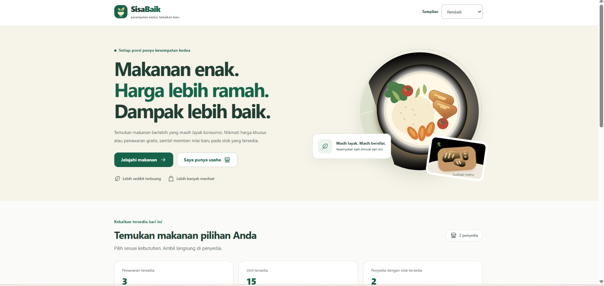
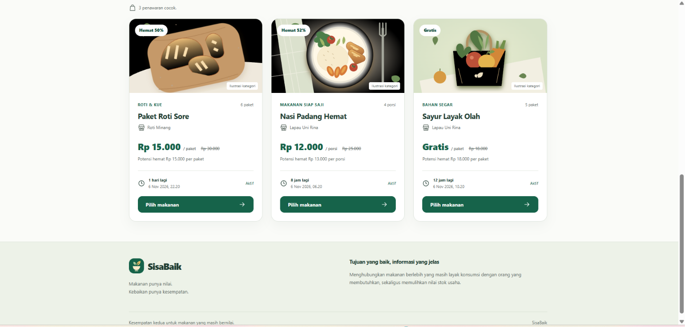
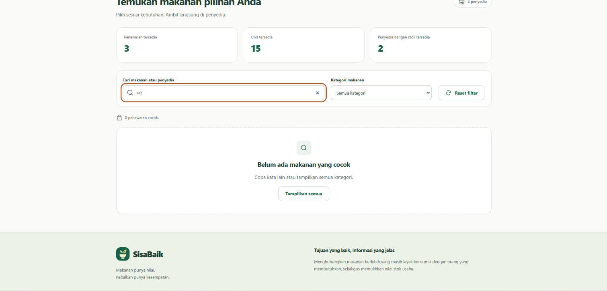
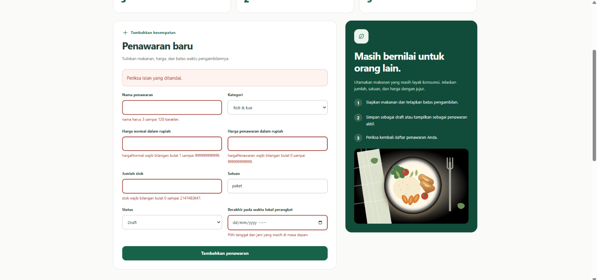
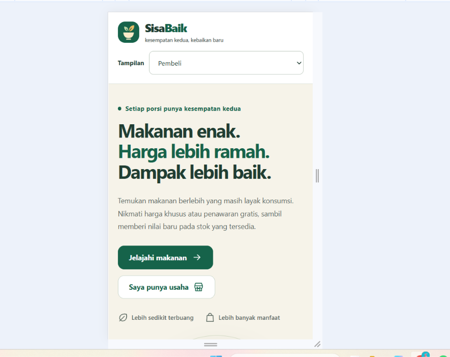
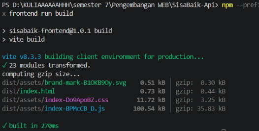

# Hasil Pengujian Modul 9 – SisaBaik Frontend

## 1. Informasi Pengujian

- Penguji: Fazila Nur Hasyidah
- Branch: `feature/vue-components`
- Versi Node.js: `v24.21.0`
- Versi npm: `11.19.0`
- Versi Vite: `8.3.3`

## 2. Hasil Pengujian

| No. | Skenario Pengujian | Hasil Aktual                                                                  | Status   |
| --- | ------------------ | ----------------------------------------------------------------------------- | -------- |
| 1   | Katalog penawaran  | Katalog berhasil ditampilkan dengan daftar penawaran yang tersedia.           | Berhasil |
| 2   | Empty state        | Tampilan kondisi kosong berhasil ditampilkan ketika tidak terdapat penawaran. | Berhasil |
| 3   | Form invalid       | Validasi berhasil mendeteksi input yang tidak sesuai ketentuan.               | Berhasil |
| 4   | Form valid         | Form berhasil menerima input yang memenuhi ketentuan validasi.                | Berhasil |
| 5   | Tampilan mobile    | Tampilan frontend berhasil menyesuaikan ukuran layar perangkat mobile.        | Berhasil |
| 6   | Production build   | Sebanyak 23 modul berhasil ditransformasikan dalam waktu 270 ms tanpa error.  | Berhasil |

## 3. Aliran Props dan Emits

Aliran data pada frontend SisaBaik menggunakan mekanisme props dan emits pada Vue 3.

### KartuPenawaran.vue

Props yang diterima:

- `penawaran`: data penawaran yang ditampilkan.
- `waktuSekarang`: waktu saat ini untuk menghitung sisa waktu penawaran.
- `bolehPilih`: menentukan apakah tombol pemilihan dapat digunakan.

Emits:

- `pilih`: mengirimkan ID penawaran kepada komponen induk ketika pengguna memilih penawaran.

### Aliran Data

Komponen induk `App.vue` mengelola data dan meneruskannya kepada komponen anak melalui props. Komponen anak menampilkan data sesuai kebutuhan. Ketika terjadi interaksi pengguna, komponen anak mengirimkan event melalui emits agar dapat ditangani oleh komponen induk.

## 4. Perhitungan Ringkasan

### Ringkasan Pembeli

Ringkasan pembeli digunakan untuk memberikan informasi mengenai penawaran yang tersedia dan aktivitas pemilihan penawaran. Perhitungan mengikuti data fixture lokal yang digunakan pada frontend.

### Ringkasan Penyedia

Ringkasan penyedia digunakan untuk memberikan informasi mengenai penawaran yang dikelola oleh penyedia, termasuk jumlah penawaran dan status penawarannya. Perhitungan mengikuti data fixture lokal yang digunakan pada frontend.

## 5. Arsitektur dan Integrasi

Frontend Modul 9 dikembangkan menggunakan Vue 3 dan Vite. Data penawaran menggunakan fixture lokal di memori sebagai sumber data untuk menampilkan informasi dan menjalankan interaksi pada halaman frontend.

Pada modul ini, browser tidak melakukan pemanggilan API backend.

Backend Modul 8 tetap memiliki fitur pendaftaran mandiri, verifikasi penyedia, autentikasi, dan otorisasi. Integrasi antara frontend dan backend direncanakan untuk dilaksanakan pada pertemuan 11.

## 6. Bukti Pengujian

### 6.1 Katalog Penawaran

### 6.2 Empty State

### 6.3 Form Invalid

### 6.4 Form Valid

### 6.5 Tampilan Mobile

### 6.6 Production Build

